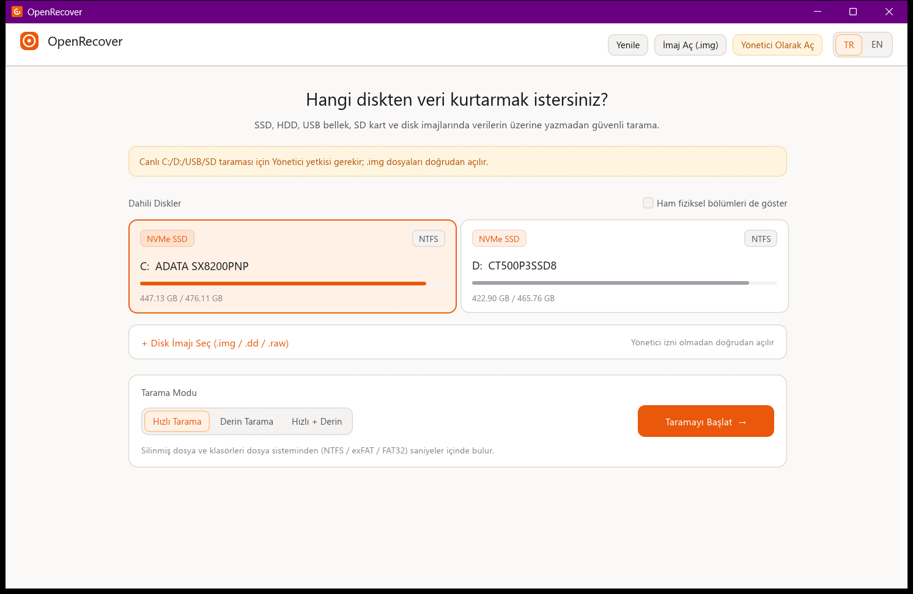
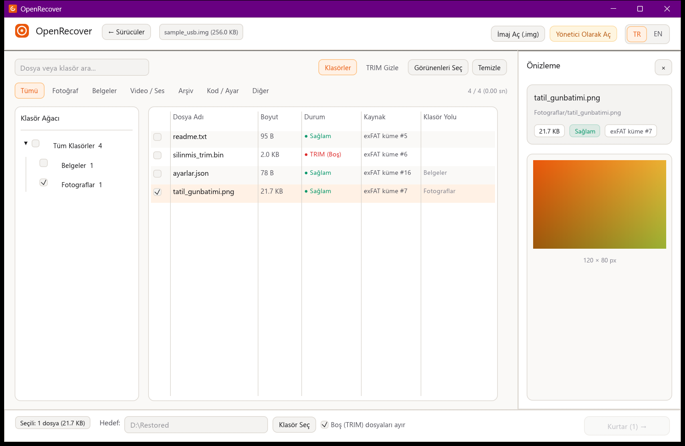

# OpenRecover

[](https://github.com/Cukkoo12/OpenRecover/actions/workflows/release.yml)
[](https://github.com/Cukkoo12/OpenRecover/releases/latest)
[](LICENSE)
[](Cargo.toml)

**[Türkçe](#türkçe) · [English](#english) · [Download Windows x64 (`openrecover.exe`)](https://github.com/Cukkoo12/OpenRecover/releases/latest/download/openrecover.exe)**

Free, fast, open-source data recovery for **SSDs, HDDs, USB flash drives, SD/microSD cards, and disk images** — a lightweight, zero-paywall open-source alternative to paid recovery software (built in Pure Rust with `eframe` / `egui`).  
**SSD, HDD, USB bellek, SD/microSD kart ve disk imajları** için ücretsiz, kotasız ve açık kaynak veri/dosya kurtarma uygulaması.

---

### Screenshots / Ekran Görüntüleri

| Drive Selection / Kaynak Seçimi | Results & Live Preview / Sonuçlar & Canlı Önizleme |
| :---: | :---: |
|  |  |

---

## Türkçe

**Ücretsiz, sınırsız ve açık kaynak dosya kurtarma programı.**  
500 MB sınırı, dosya sayısı kotası veya abonelik yok. Klasör ağacını koruyarak kurtarma, derin sektör taraması ve kurtarma öncesi canlı önizleme sunar.

### İndirme (Kurulum Gerektirmez)
- **[GitHub Releases (v0.1.0)](https://github.com/Cukkoo12/OpenRecover/releases/latest)** sayfasından tek başına çalışan **[openrecover.exe](https://github.com/Cukkoo12/OpenRecover/releases/latest/download/openrecover.exe)** (`~14.8 MB`) dosyasını veya `OpenRecover-v0.1.0-windows-x64.zip` paketini indirebilirsiniz.

### Özellikler

- **Çoklu Cihaz & İmaj Desteği:** Dahili SSD/HDD (`NVMe`, `SATA`), çıkarılabilir `USB` bellekler, `SD/microSD` kartlar, ham `PhysicalDrive` bölümleri (MBR & GPT) ve `.img` / `.dd` / `.raw` / `.bin` disk imajları.
- **Saf Rust Dosya Sistemi Motoru:**
  - **NTFS:** Tamponlu hızlı `$MFT` tarayıcı, USA fixup, `$ATTRIBUTE_LIST`, yerleşik (resident) dosyalar, işaretli datarun ve sparse/LZNT1 sıkıştırılmış akışlar, silinen klasörlerde `SequenceNumber + 1` ile ağaç kurma.
  - **exFAT:** `0x05 / 0x40 / 0x41` silinmiş dizin kayıtları, UTF-16LE dosya adları ve alt klasör taraması.
  - **FAT32:** `0xE5` silinmiş kayıtlar ve UCS-2 uzun dosya adı (`LFN`) geri yükleme.
  - **Derin Tarama (Raw Carving):** `JPG` (gömülü EXIF küçük resimlerini atlayarak), `PNG` (`IEND` blok kontrollü), `GIF`, `BMP`, `WEBP`, `MP4/MOV`, `WAV`, `AVI`, `PDF`, `ZIP/DOCX/XLSX` ve `SQLite` imzaları.
- **SSD TRIM Tespiti:** Tamamı sıfırlanmış (TRIM yemiş) dosyaları kurtarma sırasında otomatik olarak `_TRIM_Zeroed` altına ayırır.
- **Kurtarma Öncesi Canlı Önizleme:** Fotoğraflar (`PNG`, `JPG`, `GIF`, `BMP`, `WEBP`), UTF-8 metin/JSON/kod dosyaları ve Hex dökümü uygulama içinden canlı görüntülenir.
- **Aynı Disk Koruma Kilidi:** Taranan sürücü üzerine geri yazmayı engelleyerek silinmiş verilerin üzerine yazılmasını önler.
- **Modern Turuncu-Beyaz Arayüz & Çift Dil (`TR | EN`):** Uygulama içinden anlık Türkçe / İngilizce geçiş.
- **Otomasyon İçin CLI (`openrecover-cli`):** Betik ve terminal kullanımı için hafif komut satırı aracı.

### Kaynaktan Derleme

```bash
cargo test --locked
cargo build --release --locked
```

Çıktılar `target/release/openrecover.exe` (GUI) ve `target/release/openrecover-cli.exe` (CLI) konumunda oluşur.

> **Windows Notu:** Canlı `C:`, `D:`, USB bellek veya SD kart blok cihazlarını okumak için Yönetici yetkisi gerekir (üst çubuktan **"Yönetici Olarak Aç"** butonuna tıklayın). `.img` / `.dd` / `.raw` disk imajları yönetici izni olmadan açılır; isterseniz doğrudan şu şekilde başlatabilirsiniz:
> ```powershell
> openrecover.exe disk_imaji.img --scan
> ```

### CLI Kullanımı

```powershell
# Algılanan diskleri ve bölümleri listele
openrecover-cli list

# C: diskinde silinen AppData/Roaming dosyalarını tara ve güvenle D:\Restored içine çıkar
openrecover-cli scan C: --mode quick --filter AppData/Roaming --out D:\Restored

# Bir SD kart imajında Hızlı + Derin (birleşik) tarama yap
openrecover-cli scan sdcard.img --mode combined --out D:\SD_Recovered
```

---

## English

**Zero paywalls. Zero 500 MB / 4,000-file limits.**  
Full folder-tree reconstruction + sector-level signature carving + live preview before recovery — a free open-source alternative to paid data recovery tools.

### Download (Portable, No Installer)
- Grab the standalone **[openrecover.exe](https://github.com/Cukkoo12/OpenRecover/releases/latest/download/openrecover.exe)** (`~14.8 MB`) or the full archive from **[GitHub Releases](https://github.com/Cukkoo12/OpenRecover/releases/latest)**.

### Features

- **Multi-Device Support:** Internal SSD/HDD (`NVMe`, `SATA`), removable `USB` flash drives, `SD/microSD` memory cards, raw unmounted `PhysicalDrive` partitions (MBR & GPT), and `.img` / `.dd` / `.raw` / `.bin` disk images.
- **Multi-Filesystem Engine (Pure Rust):**
  - **NTFS:** High-speed buffered `$MFT` parser with USA fixup, `$ATTRIBUTE_LIST`, resident inline data, variable-length signed dataruns, sparse & LZNT1 compressed streams, and deleted directory `SequenceNumber + 1` folder-tree reconstruction.
  - **exFAT:** Deleted `0x05 / 0x40 / 0x41` directory entries with UTF-16LE filenames and recursive deleted-subfolder traversal.
  - **FAT32:** Deleted `0xE5` entries with Long File Name (`LFN`) UCS-2 reconstruction and FAT-chain / contiguous recovery.
  - **Deep Scan (RAW Signatures):** Exact boundary/header carving for `JPG` (skipping embedded EXIF thumbnails), `PNG` (chunk-accurate `IEND`), `GIF`, `BMP`, `WEBP`, `MP4/MOV`, `WAV`, `AVI`, `PDF`, `ZIP/DOCX/XLSX`, and `SQLite`.
- **SSD TRIM Detection:** Automatically checks file headers and separates all-zero TRIMmed files into `_TRIM_Zeroed` during recovery so clean folders stay reliable.
- **Live Preview Before Recovery:** Renders recovered photos (`PNG`, `JPG`, `GIF`, `BMP`, `WEBP`), UTF-8 text/JSON/code files, and Hex/ASCII headers inside the UI.
- **Same-Drive Safety Guard:** Blocks recovering files onto the same source volume you are scanning so you never overwrite deleted data.
- **Bilingual UI:** Switch live between **TR** and **EN** inside the app.
- **Bonus CLI (`openrecover-cli`):** Scriptable command-line tool for headless/automation workflows.

### Building from Source

```bash
cargo test --locked
cargo build --release --locked
```

Binaries are output to `target/release/openrecover.exe` and `target/release/openrecover-cli.exe`.

> **Windows Note:** Reading live `C:`, `D:`, USB, or SD card block devices requires Administrator privileges (click **"Run as Admin / Yönetici Olarak Aç"** in the top bar). Opening `.img` / `.dd` disk image files works without Admin privileges — you can also launch `openrecover.exe path\to\disk.img --scan` directly.

### CLI Usage

```bash
# List detected volumes & physical drives
openrecover-cli list

# Scan C: for deleted AppData/Roaming files and extract safely to D:\Restored
openrecover-cli scan C: --mode quick --filter AppData/Roaming --out D:\Restored

# Combined tree + deep carving on an SD card disk image
openrecover-cli scan sdcard.img --mode combined --out D:\SD_Recovered
```

---

## License / Lisans

[MIT](LICENSE)
